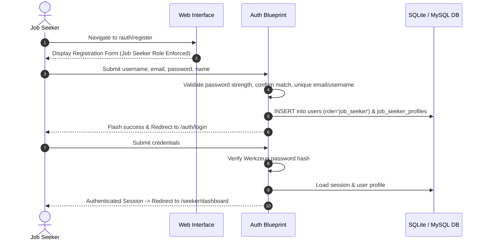
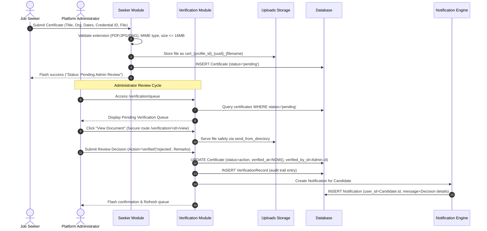
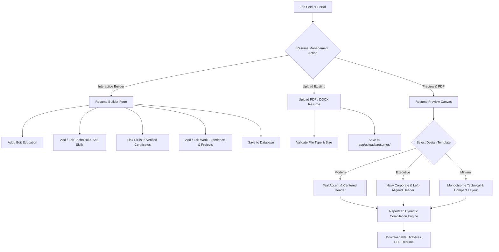

# Application Workflow Documentation

**Skill Resume Certificate Verification System**

---

## 1. Candidate Registration & Authentication Workflow



### Password Recovery Workflow
1. User clicks **"Forgot password?"** on the login page (`/auth/forgot-password`).
2. Enters registered email address.
3. System generates a secure `itsdangerous` timed cryptographic token (30-minute validity) and generates a reset link (`/auth/reset-password/<token>`).
4. User accesses the link, specifies a new compliant password, and the system hashes and updates `users.password_hash`.

---

## 2. Certificate Upload & Human-in-the-Loop Verification Workflow

The core USP of the platform is that **no certificate is ever automatically verified**. Every credential must undergo manual human-in-the-loop review by an authorized administrator.



---

## 3. Resume Management & Multi-Template PDF Generation



---

## 4. Candidate Discovery Directory Workflow

```mermaid
graph LR
    Visitor([Public Visitor / Recruiter / Admin]) --> Direct[/candidates]
    Direct --> Filters[Search & Filter Parameters]
    Filters --> F1[Candidate Name Keyword]
    Filters --> F2[Skill Search e.g. Python, Docker]
    Filters --> F3[Degree / Institution Search]
    Filters --> F4[Verified Credentials Only Toggle]
    
    Filters --> Results[Candidate Grid Cards]
    Results --> ProfileView[Public Candidate Profile /candidates/:id]
    ProfileView --> V1[Verified Certificate Badges]
    ProfileView --> V2[Education & Experience History]
    ProfileView --> V3[Categorized Skills]
```
